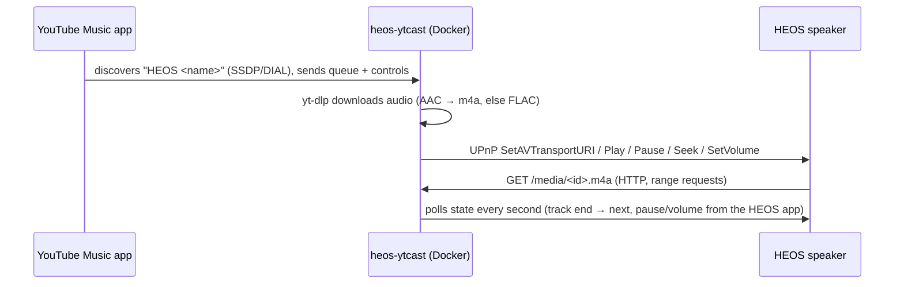

# Cast2Heos

Makes a HEOS speaker show up in the **Cast** menu of the YouTube Music and YouTube apps (Android, iOS, desktop Chrome).

HEOS speakers can't do Google Cast. This bridge implements YouTube's own TV casting protocol (DIAL + Lounge API, via [yt-cast-receiver](https://github.com/patrickkfkan/yt-cast-receiver)), so the app treats it like a smart TV. It fetches the audio with [yt-dlp](https://github.com/yt-dlp/yt-dlp) and has the speaker play it over UPnP/DLNA.



## Requirements

- Docker host on the same LAN/subnet as the phone and the speaker (multicast discovery doesn't cross subnets/VLANs).
- **Host networking** (`network_mode: host`). With bridge networking the app will not find the device.
- Ports 8098 (media server) and 8099 (DIAL) free on the host; change via `HTTP_PORT` / `DIAL_PORT`.

## Unraid setup

Give the speaker a fixed IP first (DHCP reservation in the router); it goes into `HEOS_HOST`.

### Option A: image from GitHub (recommended)

Pushing to `main` (or a `v*` tag) runs `.github/workflows/docker.yml`. It builds the image and publishes it to the GitHub Container Registry as `ghcr.io/slothinger/cast2heos:latest`. Docker Hub is not needed.

1. Push the repo to GitHub. Check the **Actions** tab to see if the build passed.
2. If the repo is private, the image is private too. Either set the package to public (GitHub → your profile → **Packages** → package → **Package settings** → **Change visibility**), or log Unraid in once from its terminal with a token that has the `read:packages` permission:
   `docker login ghcr.io -u Slothinger`
3. Unraid → **Docker** → **Add Container**:
   - **Name:** `heos-ytcast`
   - **Repository:** `ghcr.io/slothinger/cast2heos:latest`
   - **Network Type:** `Host`
   - **Add another Path, Port, Variable…** → Variable: key `HEOS_HOST`, value `192.168.1.62`
   - **Add another Path, Port, Variable…** → Path: container `/data`, host `/mnt/user/appdata/heos-ytcast`
4. **Apply**. Updates: push to GitHub, wait for the build, then use **Check for Updates** → **Update** in the Docker tab.

### Option B: build on the server

Copy this folder to e.g. `/mnt/user/appdata/heos-ytcast/src`, set `HEOS_HOST` in `docker-compose.yml`, then run in the Unraid terminal:

```sh
cd /mnt/user/appdata/heos-ytcast/src
docker compose up -d --build     # needs the Compose Manager plugin
# or without compose:
docker build -t heos-ytcast .
docker run -d --name heos-ytcast --network host --restart unless-stopped \
  -e HEOS_HOST=192.168.1.62 -v /mnt/user/appdata/heos-ytcast:/data heos-ytcast
```

To update, rerun the build and recreate the container.

### Check

`docker logs -f heos-ytcast` should show `"HEOS <name>" ready`. In YouTube Music, tap the Cast icon → **HEOS <name>**.

## Configuration

| Variable | Default | Purpose |
|---|---|---|
| `HEOS_HOST` | – (required) | IP of the HEOS speaker |
| `DEVICE_NAME` | `HEOS <speaker name>` | Name in the Cast menu |
| `BRIDGE_HOST` | auto | IP the speaker uses to reach the bridge; auto-detected from the route to `HEOS_HOST`. Set it if the host has several interfaces on the speaker's network. |
| `HTTP_PORT` | `8098` | Media server port |
| `DIAL_PORT` | `8099` | DIAL/discovery port |
| `DATA_DIR` | `/data` | Receiver identity (keeps one stable Cast menu entry); mount it |
| `CACHE_DIR` | `/tmp/heos-ytcast` | Downloaded audio (last 40 tracks, cleared on start) |
| `YTDLP_AUTO_UPDATE` | `true` | Run `yt-dlp -U` on start. YouTube changes often; restarting the container picks up fixes. |
| `YTDLP_COOKIES` | – | Path to a Netscape cookies file (e.g. `/data/cookies.txt`) for age-restricted/members-only tracks or if YouTube asks to "confirm you're not a bot" |
| `LOG_LEVEL` | `info` | `error`, `warn`, `info`, `debug` |

## Behaviour and limits

- **First song takes ~8 s to start.** YouTube makes clients wait a few seconds before a stream URL works, and yt-dlp honours that wait. The next track in the queue is downloaded in the background, so track changes are quicker.
- Play, pause, seek, skip, previous, volume and queue edits from the app work. Pausing or changing the volume on the speaker or in the HEOS app is reflected in the app.
- If you switch the speaker to another source (Spotify, AirPlay, …), the cast session shows as stopped. Disconnecting the app stops our playback, but never another source.
- Audio is YouTube's AAC (~128 kbit/s), remuxed without re-encoding. If a video has no AAC stream, its audio is converted to FLAC.
- Uploaded/private tracks from your library are not supported (they need your account's credentials).
- Fetching streams with yt-dlp is against YouTube's terms of service. When YouTube changes things, playback breaks until yt-dlp is updated (restart the container).
- The HEOS CLI (port 1255) is not used; some firmware versions don't expose it. Control is via the speaker's UPnP MediaRenderer on port 60006.

## Development

Requires Node ≥ 20.10, `ffmpeg` and `yt-dlp` on `PATH`.

```sh
npm install
HEOS_HOST=192.168.1.62 DATA_DIR=./data npm start
```
